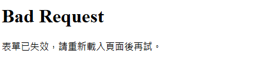
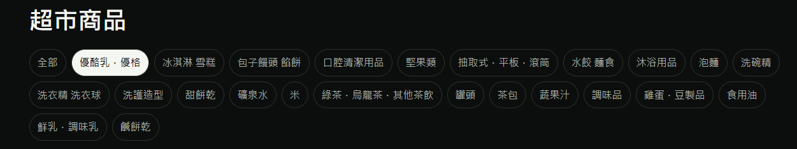
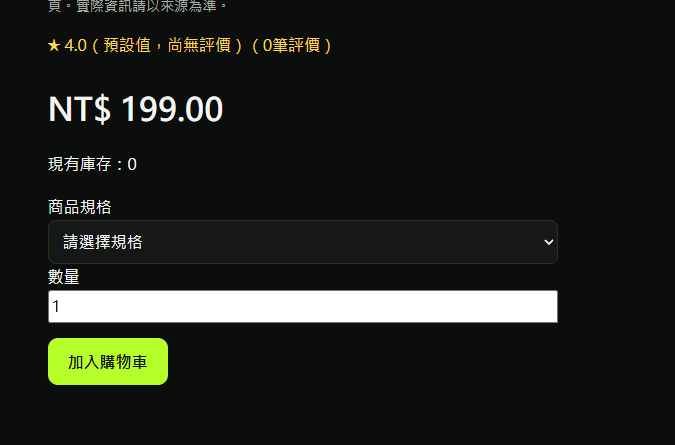
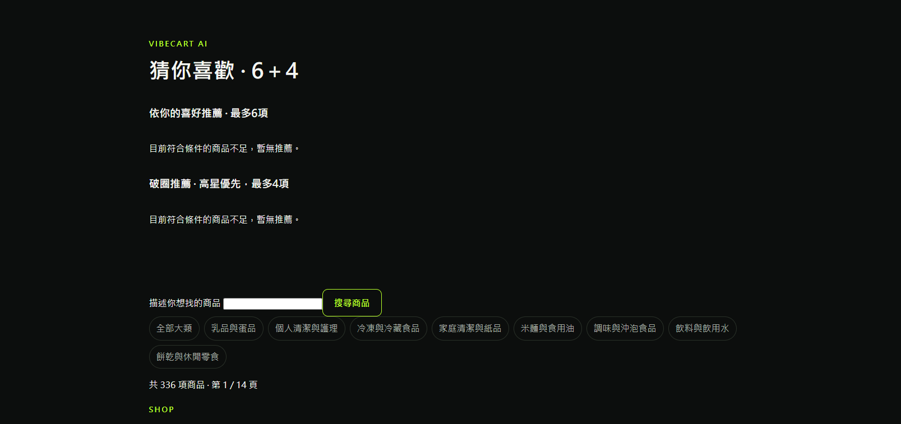
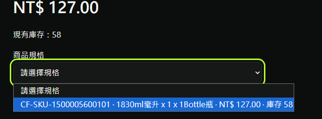
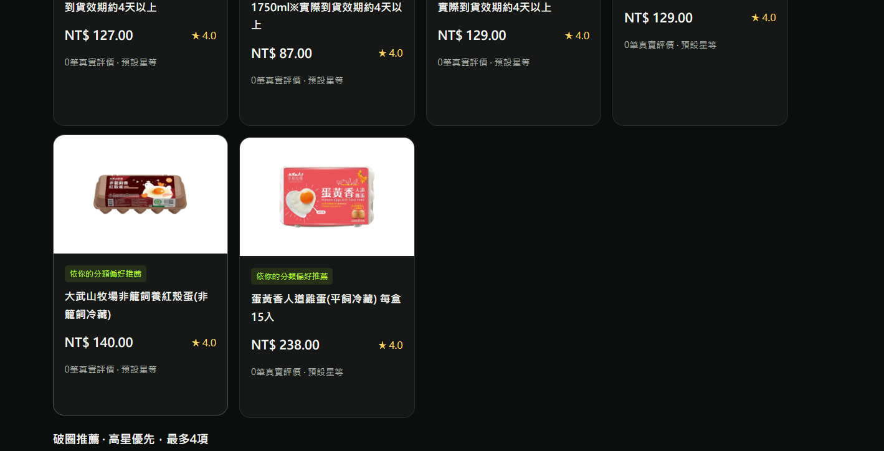
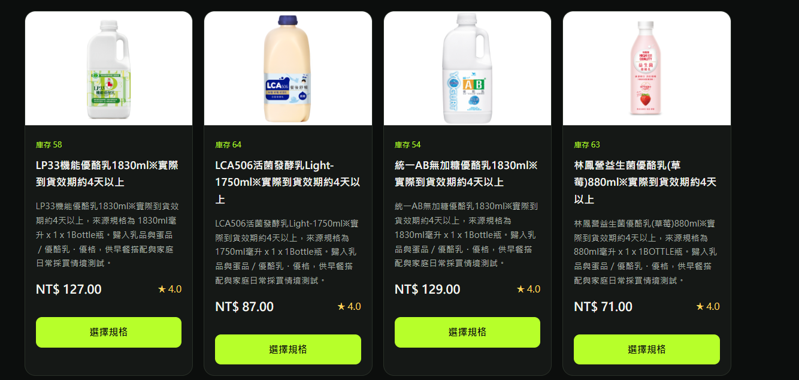
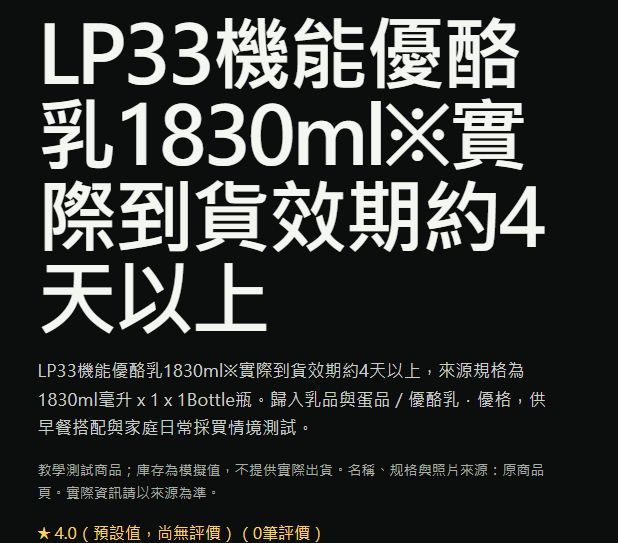
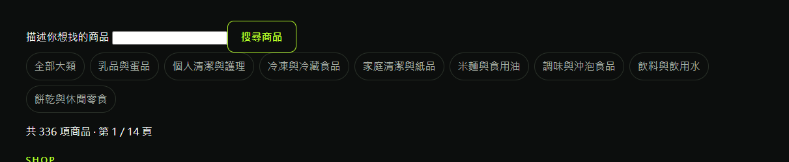

# JEFF 前台使用回報｜2026-10-21

**接續結果（2026-10-21 21:59 發布）**：下列 F01～F12 已依 [PR #166](https://github.com/SamWang61/LLM_PJ/pull/166) 完成技術改善，逐項對應、速度前後比較、449 項測試與正式操作原圖見[交付報告](FRONTEND_PERFORMANCE_2026-10-21.md)。登入 POST／首頁／商品頁暖機中位數分別為 0.583／0.715／0.597 秒；18 組正式瀏覽器操作通過。保留原回報、建議及初步原因供追溯；本次未採會令庫存過期的目錄快取，JEFF 本人複驗及實機簽收另列。

回報人：[JEFF](mailto:jeff841117@gmail.com)（AI／後台負責人，以會員身分實際操作正式站時發現）。
處理人：[SAM](mailto:cashsam@gmail.com)（前台／RWD 與整合）。JEFF 不修改前台，本文件只提供問題、證據、初步原因與建議。

- 正式站：<https://vibecart-llmai.web.app>
- 比對版本：GitHub main `c66f731`；正式部署來源 `fc4e7c0`（相關前台檔案兩者 Git blob 相同）
- 審查補充（2026-10-21）：本文保留上述版本的使用回報與初步診斷。最新部署／修正狀態以 [優化系統](優化系統.md) 及 [CURRENT_CONTEXT](CURRENT_CONTEXT.md) 為準；回報中的 P0／P1 是原回報者的排程建議，不代表本輪已重現的缺陷等級。
- 截圖：本站畫面存於 [evidence/jeff-frontend-issues-20261021](evidence/jeff-frontend-issues-20261021/)。參考網站 <https://www.notorious-2019.com/> 的畫面屬第三方著作，**不收進 repo**，以文字描述其做法，請直接開網站對照。

## 摘要與建議優先順序

| # | 問題 | 類型 | 建議優先 |
|---|---|---|---|
| F01 | 登入／登出偶發 400「表單已失效」，但實際已成功 | 錯誤流程 | **P0** |
| F11 | 每頁伺服器回應約 2.1 秒，登入後更慢 | 效能 | **P0**（與 F01 相關） |
| F04 | 標籤／分類篩選慢 | 效能 | P0（同 F11 根因） |
| F08 | 庫存 0 仍可按「加入購物車」 | 購物流程 | P1 |
| F02 | 「猜你喜歡」無資料時只顯示「暫無推薦」 | UX | P1 |
| F06 | 商品規格欄位顯示 SKU 代碼等內部資料；數量欄位簡陋 | UX | P1 |
| F10 | 商品卡只有名稱與按鈕可點；推薦卡與一般卡樣式不一致 | UX | P1 |
| F05 | 商品卡「選擇規格」按鈕未對齊 | 切版 | P2 |
| F07 | 商品頁標題與介紹文字未排版 | 切版 | P2 |
| F03 | 搜尋區塊過空、分類標籤直接攤開 | 版面 | P2 |
| F09 | 商品頁「上一項／下一項」不符一般購物網站，應改相關推薦 | UX | P2 |
| F12 | 購物車頁面簡陋 | UX | P2 |

---

## F01｜登入／登出偶發 400「表單已失效」（P0）

**現象**：輸入密碼登入、或按登出時，偶爾出現純文字的 `Bad Request／表單已失效，請重新載入頁面後再試。`。重新整理後發現**其實已經登入（或已登出）**。多試幾次後無法穩定重現。

**JEFF 實測（10/20，以不存在的測試信箱）**：

| 測試 | 結果 |
|---|---|
| 先 GET 登入頁取得 `__session`，再 POST | 通過 CSRF，回「帳號或密碼不正確」（正常） |
| 不帶 session、用同一個 token POST | 400「表單已失效」（與畫面相同） |

**初步原因（程式碼）**：

1. `app/auth.py` 登入成功（第 67 行）與登出（第 191 行）都會 `session.clear()`，把 `csrf_token` 一併清掉。
2. `app/security.py` 的 `protect_forms()` 要求每個 POST 的 token 等於 session 內的 `csrf_token`。
3. 登入／登出表單沒有防重複送出（`templates/auth/login.html` 的按鈕無 disabled 處理），且每次請求需 2 秒以上（見 F11）。使用者**按兩次、或按 Enter 又點按鈕**時：第一個請求成功並清空 session，第二個請求帶舊 token → 400。結果就是「顯示失敗，但其實成功」。
4. 另開多個分頁、或頁面放太久，也會造成同樣結果。

**建議**：
- 送出後立即停用按鈕（前端 JS），避免重複送出。
- `session.clear()` 之後重新產生 `csrf_token`。
- 登入／登出若要容忍重複提交，必須確認是同一次有效操作；登入還須確認此次憑證仍對應已登入身分。缺少、猜測或不相符的 token，以及改用另一角色憑證的舊表單，仍應拒絕，不能只依「目前已登入」略過檢查。
- 400 頁改用網站版型，提供「回首頁／重新登入」按鈕，不要只有純文字。

## F11｜整站回應慢（P0）／F04｜標籤篩選慢（P0）

**JEFF 實測（10/21，匿名、各 3 次，伺服器首位元組時間 TTFB）**：

| 路徑 | TTFB |
|---|---|
| `/`（首頁） | 2.17～2.24 秒 |
| `/?major=乳品與蛋品`（大類標籤） | 2.16～2.31 秒 |
| `/product/<id>`（商品頁） | 2.10～2.13 秒 |
| `/health/live`（不連資料庫） | 0.31～0.37 秒 |

不碰資料庫的頁面 0.3 秒，碰資料庫的頁面都多出約 1.8 秒；登入後還要讀會員事件、算 6+4，體感 4 秒以上。

**初步原因（程式碼）**：

1. `app/db.py` 的 `get_db()` **每個請求都新建一個 `MongoClient` 並執行 `ping`**，請求結束再關閉。每次都要重做 SRV DNS 查詢、對 Atlas 三個節點建立 TLS 連線，經固定 NAT 出口，這是主要延遲。
2. `app/services/sku_gateway.py` 的 `catalog()` 每次都讀**全部** 336 商品＋SKU＋分類；首頁、標籤篩選，甚至**商品頁**（為了算上一項／下一項）都會呼叫。標籤篩選不是只查該分類，而是全部讀出後在 Python 過濾。

**建議**：
- 改為**全程序共用一個 `MongoClient`**（連線池），不要每請求建立與 ping；這一項預期可省下大部分的 1.8 秒。
- `catalog()` 加短時間快取（例如 60 秒），或標籤篩選改為資料庫查詢條件。
- 商品頁不要為上一項／下一項讀整個目錄（見 F09）。

## F08｜庫存 0 仍可加入購物車（P1）

**現象**：商品頁顯示「現有庫存：0」，但「加入購物車」按鈕仍可按。
**建議**：庫存 0 時停用按鈕，改顯示「已售完，補貨中」；數量欄同時停用。後端也應拒絕（SKU 服務若已拒絕，前端要顯示清楚原因）。

## F02｜「猜你喜歡」無資料時的處理（P1）

**現象**：兩區都顯示「目前符合條件的商品不足，暫無推薦。」，在首頁最上方佔大片空間。
**背景**：回報當時此會員的冷啟動推薦沒有符合條件的候選。現行 6+4 的冷啟動探索及破圈候選要求實際評價 ≥ 4.5；有個人行為時，個人區塊也可能納入符合偏好但尚無評價的商品，不能把星等門檻套用到所有推薦。空白是否合理須依當次會員行為、可售候選及各區規則核對，本文不宣稱目前正式資料的即時合格數量。
**建議**（擇一，需 SAM／JEFF 共同決定，牽涉推薦規格）：
- 無資料時**整區隱藏**；或
- 退回顯示「熱門商品／新品」並清楚標示「熱門推薦」而非「猜你喜歡」（不可假裝是個人化結果，也不灌假星等）。

## F06｜商品規格與數量欄位（P1）

**現象**：規格下拉直接顯示 `CF-SKU-1500005600101 · 1830ml毫升 x 1 x 1Bottle瓶 · NT$ 127.00 · 庫存 58`，把 SKU 代碼等內部資料給會員看；數量是單純輸入框。
**建議**：
- 規格只顯示會員需要的屬性（容量、口味、尺寸）；多規格時用按鈕／色塊選擇，**選了之後價格與庫存跟著變動**。
- 數量改成「－ 數字 ＋」組合，可手動輸入也可左右調整，並限制在 1～可售量。
- 參考：參考網站商品頁的「產品口味」色塊、「商品規格」按鈕、「數量 －1＋」。

## F10｜商品卡可點範圍與推薦卡一致性（P1）

**現象**：一般商品卡只有名稱和「選擇規格」按鈕可點；推薦卡沒有規格按鈕，兩種卡樣式不一致。
**建議**：
- **整張卡片包成一個連結**到商品頁（圖片、名稱、價格都可點）。
- 一般列表卡不需要「選擇規格」按鈕，規格在商品頁選。
- 推薦卡與一般卡使用同一個元件，推薦卡只多一個推薦理由標籤。
- 參考：參考網站「相關商品」卡片，整張可點、圖片＋品牌＋名稱＋價格。

## F05｜商品卡按鈕未對齊（P2）

**現象**：商品名稱與描述長短不同，導致價格與「選擇規格」按鈕上下不齊。
**建議**：卡片使用 flex column，內容區 `flex: 1`，價格與按鈕固定貼齊卡片底部；描述限制行數（line-clamp）。

## F07｜商品頁標題與介紹未排版（P2）

**現象**：商品名稱以超大字級整段換行，佔滿半個畫面；介紹文字擠成一段。
**建議**：商品名稱字級縮小（約 24～28px）、限制寬度；介紹分段、條列重點，過長時「顯示更多／顯示更少」收合。參考網站的商品說明區即採此做法。

## F03｜搜尋區塊與分類標籤（P2）

**現象**：「描述你想找的商品」搜尋區空間大、輸入框小；所有大類標籤直接攤開在搜尋框下方。
**建議**：搜尋框放到頁首固定位置（圓角輸入框＋放大鏡圖示）；分類改成「產品選單」下拉或側邊選單，不在首頁攤開。參考網站頁首即為「產品選單」＋右側搜尋框。

## F09｜商品頁「上一項／下一項」（P2）

**現象**：商品頁提供依列表順序的上一項／下一項，一般購物網站少見，且需要讀整個目錄（加重 F11）。
**建議**：改為「相關商品」區塊（同小類或語意相近）；可直接使用 JEFF 已完成的 BGE 相似商品服務 `app/services/local_ai.py` 的結果，或先以同小類熱門商品取代。

## F12｜購物車頁面（P2）

**現象**：購物車頁只有基本列表。
**建議**：表格化呈現商品圖、名稱、規格、單價、數量（－＋）、小計、刪除；右側固定摘要卡（小計、運費、總計、結帳按鈕）；空購物車時提供「繼續購物」。參考網站購物車頁即為左側商品表＋右側送貨付款摘要。

---

## 與 JEFF 範圍的關係

- F02（推薦空白時的呈現）與 F09（相關商品）牽涉推薦規則，改動前請與 JEFF 確認；JEFF 可提供 BGE 相似商品或熱門退回的資料接口。
- 其餘為前台、效能與流程，由 SAM 判斷處理順序與是否列入下一階段。

English summary: Historical storefront observations refer to c66f731 / fc4e7c0. Per-request MongoClient creation and full-catalog reads are code-backed performance suspects; the timing table alone does not prove their individual contribution. Duplicate-login handling must still verify the submitted identity. The actual-rating threshold applies to cold-start exploration and cross-category candidates, not every personalized result. Current delivery evidence is tracked in the optimization document; original screenshots and priorities remain historical.
