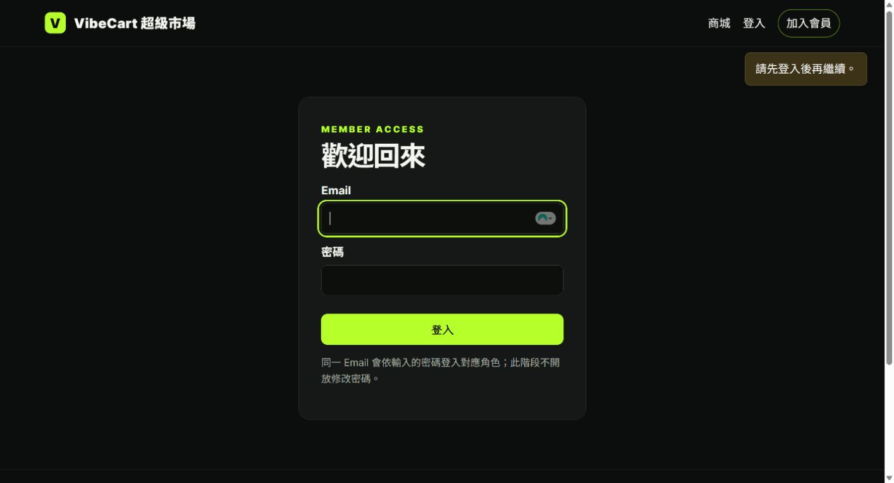

# REN 候選驗證與正式部署｜2026-10-21

完成時間：2026-10-21T19:44:36+08:00（Asia/Taipei）。執行者為 Codex 技術代理；不代填 REN 本人、真手機或異機簽收。

## 發布結果

正式入口為 <https://vibecart-llmai.web.app>；Cloud Run `vibecart-web-ren-a796-1021` Ready 並承接 **100%** 流量，來源 `a7967c3a6e2e267861ad051aed7b1527af514359`，映像 `sha256:34677e6bfd6f75433fb30836db11825fcfc91a6840e80ece0df34f2852744945`。

開始時正式站已由另輪發布到同來源的 `logout-a796-1021`。本輪先補候選驗證，再將通過驗證的完整同 digest 映像建立新正式 revision、以標記網址驗六路由，最後切換流量；保留原 revision 可回復。固定 VPC、ALL_TRAFFIC、runtime identity、Secret Manager 引用、AI 摘要旗標與其餘執行設定均與切換前相同。未以精簡映像取代現行 AI 依賴。

Hosting 現行 release `sites/vibecart-llmai/releases/1792363722745000`、version `a33b77d8155885b8`，rewrite 仍指向 `asia-east1/vibecart-web`，沒有 pinTag；因此正式入口承接本輪 Cloud Run 正式流量。本輪沒有重發未變更的 Hosting 設定。私有服務原 `five-fc4e-normal` 100% 流量保留。

## 固定來源與候選驗證

| 對象 | 本輪實際證據 |
|---|---|
| main／CI | `a7967c3` 的 [main CI](https://github.com/SamWang61/LLM_PJ/actions/runs/39493675062) 與 [Cloud Build](https://console.cloud.google.com/cloud-build/builds/df003935-d513-4bf3-9dc2-b5b1e89293c1?project=278483818008) 均成功；Cloud Build 五步 SUCCESS。 |
| 根目錄精簡候選 `00053-xas` | 固定 digest `7da758d0…`，54 個執行檔逐檔 hash 與 Git 相符，UID10001；六角色／評價與排序／會員生命週期／購物交易四組遠端探針全 passed。 |
| 完整正式映像的私有候選 `ren-a796-1021` | 同正式 digest `34677e6b…`、同樣 54 檔逐檔相符，UID10001；四組遠端探針全 passed。 |
| 清理 | 兩組各四探針均清理 verified，臨時 users email+role 索引恢復原狀；兩個自有 Job 已刪除且 GET404，自有私有測試 tag 移除、revision 保留為無 tag 的 0% 歷史。未修改 IAM。 |
| main 後續文件 | #162 已合併 `50131dd`；封裝白名單與 `a7967c3` 一致。後續本輪僅文件／去敏證據，不更動部署程式。 |

四組探針實際覆蓋：六個同 Email 不同角色的隔離身份、角色切換與撤權、單裝置登出、購物車加入／修改／移除／版本衝突、結帳重送及持久化、四類事件、唯讀後台與固定問題、商品評價資格／重複拒絕／平均無條件進位、高星排序／6＋4 去重及 synthetic 隔離。所有寫入限 `vibecart_acceptance_pr21` 的自有可清理 fixture；不代表正式站做了付款或下單。

本機完整網站 **316 passed／21 skipped**；21 項需要真本機 MongoDB replica set，這次沒有執行，不以遠端探針冒稱本機通過。來源／Cloud Build／角色／交易／評價的針對性測試另 **25 passed**。

## 正式網站功能測試

切換前及切換後，各重新驗證 SAM／JEFF／REN 的 customer、admin 共六角色：登入302、購物車200、admin允許200／customer拒絕302、四頁唯讀後台200；GET登出405、錯誤CSRF400且仍保持登入、單次POST登出302。兩獨立 REN customer Session 同時有效，登出其中一個後，舊Cookie拒絕且另一裝置仍200，最後僅登出本輪自己的 Session。密碼未改，未撤銷其他裝置。

公開 `web.app` 與 `firebaseapp.com` 各驗首頁、推薦頁、登入、live、ready為200，GET登出為405。Chrome 實際操作驗首頁336件、鮮乳搜尋14件、商品規格／價格／庫存、必選規格及匿名加入購物車導向登入；這些數量與價格僅為本輪觀察值。

原始去敏 JSON 含各項起訖、探針結果、兩個 Job 完成時間、切換操作與部署讀回：[完整證據](inventory/REN_PRODUCTION_ACCEPTANCE_2026-10-21/evidence.json)。首次建立 Job 的 API name 欄位校驗遭400，修正後才執行；讀日誌曾遇共用 quota429，改指定本專案 quota 並限制單頁後成功取得報告，未將失敗視為通過。

## 回復與未完成範圍

若需回復，先確認沒有其他發布，將正式流量切回 `vibecart-web-logout-a796-1021` 100%，再讀回 pinned digest／固定出口及兩個 Firebase 公開入口。該舊版本與本輪同 digest、同執行設定；保留它作回復，不使用沒有固定出口的更早版本。

本輪功能與發布技術驗證完成；REN 今日清單見[10/21工作清單](../專題進度/REN_今日工作清單_2026-10-21.md)。本人實機／異機、備份流程及最終逐項簽收依共同清單接續，V5 維持 **3／14**。未重匯 D1～D4、重設庫存、變更帳密或啟用新模型。

部署機制參考：[Firebase Cloud Run rewrite](https://firebase.google.com/docs/hosting/cloud-run)、[Cloud Run 流量切換](https://docs.cloud.google.com/run/docs/rollouts-rollbacks-traffic-migration)。
