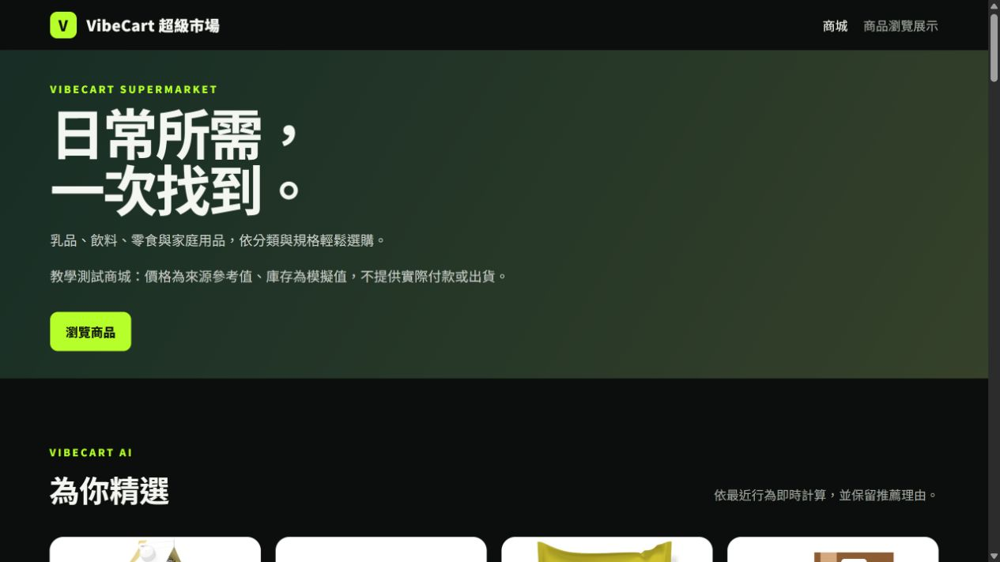
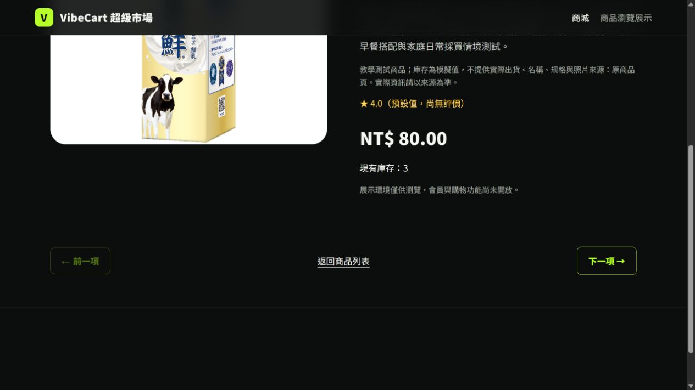

# SAM：最新 main 無流量預覽與驗收｜2026-10-18

讀回時間：2026/10/18 17:34（Asia/Taipei）。主責：[SAM](mailto:cashsam@gmail.com)。依使用者授權部署已合併的#82～#84、引用使用者建立的Claude版本1；本輪只建立預覽，正式入口維持原版本。

## 版本、路由與資料範圍

- 執行來源 **`20ee040110cbd6f02abb35aefde532a54d2fb120`**。52個Git blob白名單封裝SHA-256 **`9d0544fb3393566c759546feb46da421e9e3f4202f36b59ccff4d0e04defd285`**，2,151,544 bytes；GCS指定generation實際下載重算一致，未混入工作目錄、密鑰或備份。
- [Cloud Build](https://console.cloud.google.com/cloud-build/builds;region=asia-east1/606b023b-3489-4bc2-b98e-123c7e543d18?project=278483818008)三步SUCCESS：AI映像build、factory boot、離線BGE 512維及Claude／LangGraph imports。Registry pinned digest **`sha256:1d7b666db5b3f927e6fecf484617c2a0842694c0bfdc61150e6f3683434b4074`**。
- [公開唯讀預覽](https://main20ee-preview---vibecart-web-m44ncgz5ta-de.a.run.app)：`vibecart-web-main20ee-1640`，0%流量；應用層read-only、checkout及三AI旗標false。Atlas帳號沿用原設定，沒有把應用層限制當資料庫唯讀權限。
- 私有AI預覽：`vibecart-acceptance-pr21-main20ee-claude1-180s`，tag `main20ee-ai`、0%；同digest、獨立`vibecart_acceptance_pr21`、受限readWrite帳號、既有私有runtime身分；BGE／Claude摘要true、自由提問false，`claude-sonnet-5`，Key明確引用`ANTHROPIC_API_KEY:1`。
- 規則退回預覽：`vibecart-acceptance-pr21-main20ee-off-180s`，tag `main20ee-off`、0%；同digest，`AI_SUMMARY_ENABLED=false`且未注入Claude Key。
- **正式`vibecart-web-00019-phf`、私有base `vibecart-acceptance-pr21-00011-2hq`仍各100%**，執行來源e000d95、舊digest7199fa08…；不是最新main已正式上線。兩個新tag及fallback tag均沒有接正式百分比流量。
- Hosting release `sites/vibecart-llmai/releases/1791982222797000`、version `sites/vibecart-llmai/versions/c3772dcc7c906211`仍rewrite `vibecart-web`／`asia-east1`。沒有修改rewrite或重發Hosting；不需為這次tag預覽重部署Firebase Hosting。

## 實際驗收

1. 公開唯讀health live／ready、首頁、空搜尋、商品明細成功；登入／admin／cart／checkout GET及登入POST403，動態回應`private, no-store`。商品抽樣畫面80.00元／庫存3與同時點Atlas一致；正式事件總數1257、D4 1240在該次前後不變。這是抽樣，不是所有正式訂單的最終簽收。
2. 私有**四組雲端探針全部passed**：
   - 真BGE相似度、第二次向量全命中；會員示範購買只影響本人推薦，另一會員不變，60 synthetic不改本人結果或監控。
   - admin／customer／匿名、兩裝置、重登入舊cookie拒絕、全撤session、停用／重啟均通過；這是維運測試fixture，不是D5管理寫入UI的實作驗收。
   - 真Atlas交易：order／items／庫存持久化、重試同單、衝突409、末件庫存兩並行僅一筆成功、不可售第二SKU整單回滾；後者不是任意DB／網路故障測試。
   - normal事件監控13→14，加入1001 synthetic仍14、推薦不變；先排除再limit。這些是本次新建私有fixtures，沒有重匯正式D1～D4。
3. 四個固定問題均為真Claude來源、非空、未截斷，實測token及HTTP往返如下；相同請求快取回覆一致。**HTTP時間含網路／伺服器工作；快取命中可重用先前量測，不能當每次新API計費或冷啟動數字。**

| 固定問題 | HTTP | 輸入 / 輸出 tokens | 本次HTTP時間 |
|---|---|---|---|
| `period_compare` | 200 | 2335 / 413 | 17622 ms |
| `replenishment` | 200 | 2129 / 343 | 6143 ms |
| `promotion` | 200 | 2361 / 480 | 8526 ms |
| `revenue_change` | 200 | 2382 / 446 | 7126 ms |

4. 同版停用Claude修訂的四個問題均回規則來源且有退回／人工核對標示；兩個私有修訂自由提問POST403。這次遠端測的是**旗標停用退回**，供應商錯誤等仍引用[239／0離線契約](SAM_JEFF_PR82_84_ACCEPTANCE_2026-10-18.md)，未假稱重新在遠端注入所有故障。
5. 兩次AI探針另對實際頁面回顯payload查`ai-whitelist-v1`完整欄位、商品欄位及臨時會員email／密碼／user_id不外送；完整技術結果見[JSON](inventory/SAM_MAIN_PREVIEW_2026-10-18.json)。回答與數字的SAM抽樣核對見下方，模型仍標示需人工核對。
6. 新探針範圍／角色／實測值安全回歸**22 passed／0 skipped**；先前同版runtime已完成239／0真MongoDB回歸與32來源／fixture。這次沒有修改應用runtime，文件／探針提交與部署來源分開對帳。

## 私有請求期限修正

原停用Claude修訂首次BGE載入回HTTP504，雲端紀錄為60.001秒，沒有算通過。兩個私有0% tag已換成相同digest、180秒請求期限的新修訂，並以這兩個最終修訂重跑四組契約與停用退回。190秒BGE探針期限用來接收實際結果，不把長等待宣稱效能合格或冷啟動SLO；正式服務期限不變。

## 清理與可重現證據

- 所有探針以不可猜marker與本次ObjectId限定範圍；帳號、sessions、商品／SKU、事件、購物車、訂單及孤兒items逐範圍刪除讀回0。原Atlas正式資料未寫入。
- 最初本機HTTP探針遇間歇ReadTimeout／ConnectionError；雲端部分請求已200而本機沒有完整收到，沒有當成成功。角色拒絕實際採302回首頁，修正探針的403誤判；測試native TLS adapter的初始AttributeError也未算驗收。每次失敗均保留外部報告並完成清理、撤回自建限時OpenID grant。最終採**同project Cloud Run Job**、既有受限私有runtime身分直接取得metadata ID token，未把服務公開或加永久測試權限。
- Job及兩次成功execution名稱、inline harness SHA、五支探針來源SHA-256、52檔runtime來源與畫面hash在JSON；中間的60秒失敗另保留，不算成功。Job只執行清楚限定的私有測試，BeautifulSoup固定4.15.0；Mongo URI由版本1secret注入、ID token只在記憶體／stdin；沒有把憑證寫入Git、命令列、Cloud Build來源或報告。測後job刪除operation已完成，GET job回404。
- 重現時先以Cloud Run control plane核對tag→revision→digest、來源、0%／原100%與IAM；在相同受限runtime執行`remote_preview_ai_probe.py`及原有角色／交易／D4探針，config只由stdin提供，指定`expect_claude=true`或false。probe仍拒絕正式URI、錯誤DB／帳號／角色與未pin映像。公開HTTP不得用來替代私有交易讀回。
- 使用者已完成Key版本1 Enabled；操作與後續輪替步驟見[Claude密鑰設定](../deploy/CLAUDE_SECRET_SETUP.md)。SAM只讀版本metadata，未讀Claude Key內容。這次新增的secretAccessor binding只含原私有SA；正式SA沒有新增此權限，不宣稱排除專案管理者的既有繼承權限。既有私有invoker含該SA與專案擁有人，原policy不變；匿名403。

本次提交檔案的相對路徑與SHA-256另見[交付清單](inventory/SAM_MAIN_PREVIEW_DELIVERY_2026-10-18.json)。原工作目錄先備份再合併本輪變更，保留未提交差異；乾淨交付工作樹與Git提交才是本輪canonical來源，沒有聲稱原髒工作樹所有檔案都與main逐byte相同。

## 回答抽樣與畫面

SAM逐一對照四Claude／四規則回覆：51.25元、5筆、客單10.25、零基期不可計算、補貨候選0、兩促銷候選各可售10／售0、缺毛利與外部原因資料及示範警示均相符。商品銷量句限於products候選集合，不代表全站；本輪補貨只覆蓋無候選分支，未代替有候選排序或真人品質簽收。兩個最終修訂首次BGE探針HTTP為38.467／33.782秒，快取為1.251／1.210秒；不是冷啟動SLO。以下為公開**唯讀預覽**畫面，不是正式新版或私有AI全畫面簽收：

## V5與下一步

維持**14關卡、2完成／12待結案**；N07～N10屬下一階段。此輪補的是無流量最新main與私有模型／交易技術證據。正式新版發布、正式AI開放、受控自由提問、D5、具名接回／實機／最終簽收、全部consumer及受限區證據、N14異機key與每日流程等仍依各關卡保留。不把preview、push、CI或本機測試改寫成全站最終完成。
