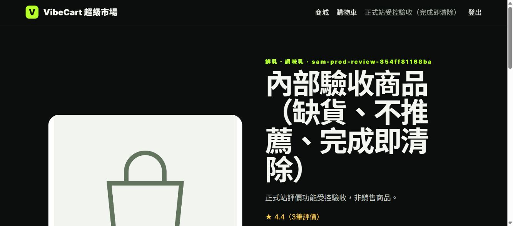
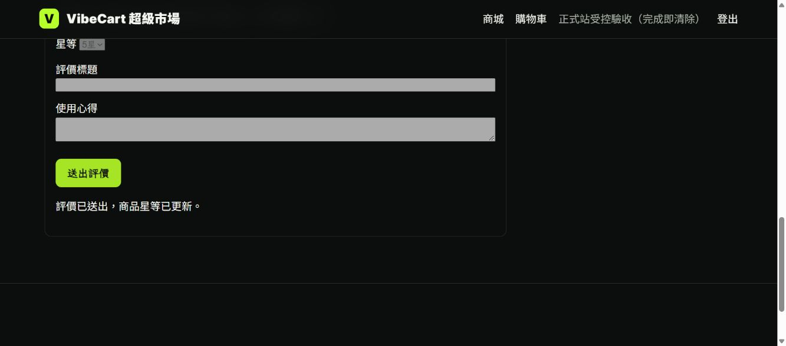

# 商品評價與猜你喜歡6＋4正式部署及驗收

日期：2026/10/19（Asia/Taipei）。本次依專案負責人要求完成正式網站部署、Firebase發布與遠端功能驗收。主責SAM；本頁接續[對話決議](../討論的相關記錄/商品評價與猜你喜歡6加4推薦_對話決議_2026-10-18.md)，保留先前0%預覽及登入修復的歷史紀錄。

## 正式發布

| 項目 | 本次實際結果 |
|---|---|
| 正式入口 | [Firebase網站](https://vibecart-llmai.web.app/)／[備用網域](https://vibecart-llmai.firebaseapp.com/) |
| Cloud Run | `vibecart-web-reviews-b038aaca`，2026/10/19 06:47切換100%正式流量，Ready成功 |
| 執行來源 | main `b038aaca2d2553a39d8fd958100f277c64a75486`的56個執行檔 |
| 不可變映像 | `asia-east1-docker.pkg.dev/vibecart-llmai/vibecart/web@sha256:8755ccb82902cf59430d5b2b76505c3fb6e4ed265d0ef98ba42821769edbcbdd` |
| Firebase Hosting | 06:48:42發布；release `1792363722745000`，version `a33b77d8155885b8`，FINALIZED |
| 路由 | `**`轉送`vibecart-web`／`asia-east1`，未固定舊revision；兩個Firebase網域均已驗證 |
| 舊版保留（06:47紀錄） | `vibecart-web-role-auth-576b4748`當時保留0%；08:40後已不適合作為直接流量回復目標，詳下方更正 |

映像原由PR #95來源`e5788ce12339370a8afb5e2c824a6ecd24e5f602`建置。本輪逐一比對56個Git blob，與main b038aaca全部相同；重新封裝archive SHA-256亦相同：`bd85ba17567bfdcff4b7d633551841df4b02a6dafee0a701fac46d969cf7fb4e`。因此直接部署已驗證的digest，沒有宣稱另建新映像。原[Cloud Build](https://console.cloud.google.com/cloud-build/builds;region=asia-east1/4e12f368-f6fd-41a7-9404-86b276e3e66b?project=278483818008)為SUCCESS。

沿用正式runtime account、兩個既有Secret Manager引用、1 CPU／512Mi／concurrency20／最多1 instance。會員與示範結帳開放；BGE、Claude摘要與自由提問旗標均false，本次上線的是可直接運作的規則6＋4。既有同Email雙角色登入及線上改密403保留；沒有重設正式密碼、寄信、變更IAM或執行migration。

## 星等與即時更新規則

- 本人已付款且完成或送達、未取消的每筆訂單明細，可給整數1～5星一次。重送相同內容維持冪等，不重複增加筆數。
- 只累計已發布評價的原始總分／筆數，預設4.0不算一筆；不得將已進位的平均再與新星數平均。
- 顯示平均為`ceil((rating_sum / rating_count) * 10) / 10`，無條件進位至小數一位。例如4＋4＋5＝13，13／3＝4.333…，顯示4.4。
- 評價與商品的總分、筆數、原始平均、顯示平均、星數分布及更新時間在同一MongoDB交易寫入；失敗回滾，提交時再驗會員／裝置session權限。
- AJAX成功後立即更新原頁星等與筆數、停用已送出表單；同來源分頁透過BroadcastChannel更新，首頁推薦片段重新查詢。動態回應`private, no-store`；不宣稱跨裝置伺服器推播。

## 猜你喜歡6＋4與主責

| 區塊 | 規範 |
|---|---|
| 個人推薦最多6項 | 依會員購買／加購／搜尋／瀏覽行為及時間衰減排序，同小類最多3項；真人示範購買可影響本人偏好，synthetic先排除 |
| 破圈最多4項 | 可售、可推薦、跨類且`ACTUAL`、顯示平均至少4.5；顯示星等→原始平均→評價筆數→合格關聯分數→商品ID排序，同小類最多2項 |
| 共同限制 | 兩區商品去重；缺貨／下架／不可推薦排除。候選不足可少於6＋4，不以預設星數或人工假評價補滿；無合格關聯統計時標示「跨類高星探索」 |

責任順序：[REN](mailto:chen2000401@gmail.com)負責會員、訂單／購物車、事件與登入契約；[JEFF](mailto:jeff841117@gmail.com)負責推薦候選、6＋4排序、consumer與關聯統計；[SAM](mailto:cashsam@gmail.com)負責資料庫、前台、整合測試、部署及證據。本次正式功能已發布，不改原團隊主責；後續排程與關聯統計仍由JEFF接續。

## 本次驗收與資料邊界

| 驗收範圍 | 結果與證據 |
|---|---|
| 真本機MongoDB | 新建無憑證replica set，275 passed／0 skipped／0 failures；fixture及容器均已清除 |
| 同映像私有遠端 | 本輪Job `sam-reviews-prod-accept-20261019-hhprv`執行4組探針：雙角色、評價與推薦、會員、Atlas交易，全部passed；暫時索引還原、fixture清理讀回、Job刪除404 |
| 高星破圈排序 | 同digest私有庫以可售隔離候選實測最多6＋4、高星排序、去重、小類上限、缺貨／預設值排除、1001 synthetic隔離；未將這些假資料匯入正式推薦池 |
| 正式版本六角色 | 切流前新revision及Firebase發布後，均使用既有私有憑證登入三人×兩角色；只建立／登出本次裝置session，正式帳密與其他裝置保留 |
| Firebase正式評價 | 在正式vibecart_ai建立一項明確標記的缺貨、不可推薦驗收商品、一名臨時會員與3筆模擬已付款完成訂單。前兩筆4星，第三筆從Chrome正式網址送5星 |
| 原頁立即更新 | 未重載，原表單仍在並全部停用；星等4.0／2筆→4.4／3筆，顯示「評價已送出，商品星等已更新。」；Atlas讀回rating_sum13、count3、raw4.333333333333333、display4.4、4星2筆／5星1筆 |
| 正式清理 | 登出後只清除本輪註冊ID的會員、session、事件、商品、SKU、訂單、明細與評價；各集合剩餘0。既有商品／庫存、會員身分、訂單／明細、評價及行為事件的數量與整體hash前後相同 |
| 正式路由 | 兩個Firebase網域的live／ready、首頁、`/recommendations`及reviews.js均HTTP200；動態頁面no-store |

以上正式訂單的paid／completed／delivered是明確的受控驗收狀態，並非真實付款或物流。沒有對既有商品加入假評價、改庫存或重匯D1～D4。正式真實評價候選不足時破圈區顯示空位；有偏好的會員個人區仍可呈現最多6項。排序正確性由同映像隔離資料驗證，不能把隔離高星商品當成正式真實評價。

首次瀏覽器送出已成功寫入Atlas，但分頁在擷取即時畫面前消失；本輪只重置該驗收商品的第三筆模擬評價，重做一次並完整取得原頁更新證據。重新GET會移除已評價表單，因此「原表單保留且停用＋成功訊息」也可區分AJAX原頁更新與重新載入。

完整[機器紀錄](inventory/reviews_production_20261019/acceptance.json)包含來源、revision／100%流量、Hosting release、探針、瀏覽器與Atlas清理。交付文件不含密碼、hash原值、URI、cookie或token。

## 回復與後續

**2026/10/19 08:40回復指示更正**：N13之後Atlas萬用IP規則已不在，正式Cloud Run改經專用VPC與固定NAT出口。08:40唯讀讀回：`vibecart-web-nat-1019`承接100%，沿用本頁評價／6＋4映像digest，`vpcAccess.egress=ALL_TRAFFIC`；舊`vibecart-web-role-auth-576b4748`及`vibecart-web-reviews-b038aaca`均沒有`vpcAccess`。因此**不可只把流量切回這兩個舊revision**；否則可能失去Atlas連線。當時的發布與驗收數據仍為歷史事實；現行網路變更見[N13驗收紀錄](SAM_N06_N13_N14_ACCEPTANCE_2026-10-19.md)。

**08:45後續讀回**：正式流量已轉到具固定出口的`vibecart-web-n06-1019`，其映像digest不同於本頁06:47驗收版；公開首頁、推薦頁、登入頁各HTTP200，但新digest的會員評價與6＋4遠端驗收仍待重跑。下方回復條件仍適用。

**08:58新映像複驗**：正式及私有Cloud Run之後均已轉為來源`294c1fa`的同一映像`sha256:796a42b6d5fd80099900abc381d4c954d21ed1bea162ad0a9a49a89355deb40a`，各100%、固定出口。以私有Atlas隔離資料重跑四組遠端探針：雙角色、評價／6＋4、會員、交易均passed。評價總分13／3筆顯示4.4，預設星數未混入；推薦6項個人＋4項跨類且10件去重，高星依5、4.9、4.8、4.7排序。四組各自清理verified，暫時索引還原；Job已刪除讀回404。[去敏機器摘要](inventory/reviews_n06_remote_20261019.json)。正式站新digest三條匿名路由200；**正式Atlas瀏覽器送評與原頁不重載畫面未在此新digest重做**，原有4.0／2→4.4／3證據仍限定06:47版。真人簽收與其餘V5關卡不因此結案。

**2026/10/20 00:06 現行正式版補驗**：[完整圖文與清理紀錄](SAM_REVIEWS_N06_FORMAL_UI_ACCEPTANCE_2026-10-20.md)。上段08:58明列的正式瀏覽器缺口已補：在同一N06 digest的公開Firebase商品頁送5星，4.0／2筆即時變為4.4／3筆，表單在原頁停用且顯示成功；正式Atlas讀回13／3／4.4，受控測試資料八集合清理0，既有業務資料快照不變。前段08:58文字保留當時歷史；本次沒有重新部署程式或Hosting。具名本人簽收及其他V5關卡仍不由此自動完成。

**2026/10/20 00:41 新AI映像接續補驗**：正式站之後由另一輪發布切到`vibecart-web-ai-294c-1020`／digest`03d01cb5…`／100%；已在新digest正式Firebase頁面重驗同樣4.0／2→4.4／3及Atlas清理，並以同digest私有0%候選重跑四組遠端探針全passed，高星6＋4排序及去重再度通過。Job刪除404、索引還原、tag移除；候選刪除400，保留無tag／0%歷史。完整[接續紀錄](SAM_REVIEWS_N06_FORMAL_UI_ACCEPTANCE_2026-10-20.md#正式映像變更後的接續驗收)與[去敏JSON](inventory/reviews_ai_formal_ui_20261020.json)區分兩輪版本；Firebase release沿用，本對話未執行AI發布或回切流量。

若後續新revision需快速回復，先確認`vibecart-web-nat-1019`仍Ready、沿用固定出口且與目前資料結構相容，再以0%候選路由驗證首頁、推薦頁、登入及資料庫讀取，才切回該已驗評價／6＋4映像並讀回100%與Firebase路由。若要回到更早的應用程式碼，須先以該舊映像建立**具相同VPC／子網與ALL_TRAFFIC設定**的新0% revision，完成Atlas連線、功能及資料相容性驗證後才可切流。Firebase rewrite沿用同服務；不要回放評價、重設帳密或放寬Atlas存取規則。後續正式會員累積評價後，高星商品於下一次推薦查詢即依規則入選。

本次完成正式部署與受控技術驗收；具名真人簽收、完整手機矩陣、付款物流、首次會員快照、完整12個月關聯統計、每日／週／月排程及效能SLO仍按各自工作清單交付。既有V5的2／14不因本次技術驗收自行改為全部完成。GitHub PR／main合併與CI以本次交付收據及GitHub最終狀態為準。
