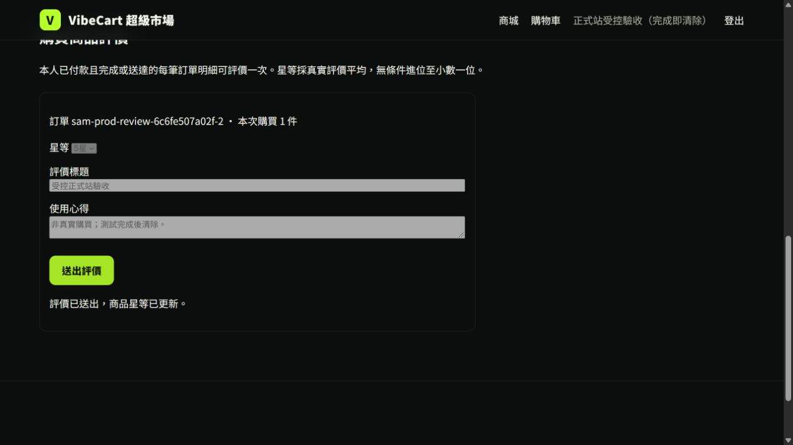
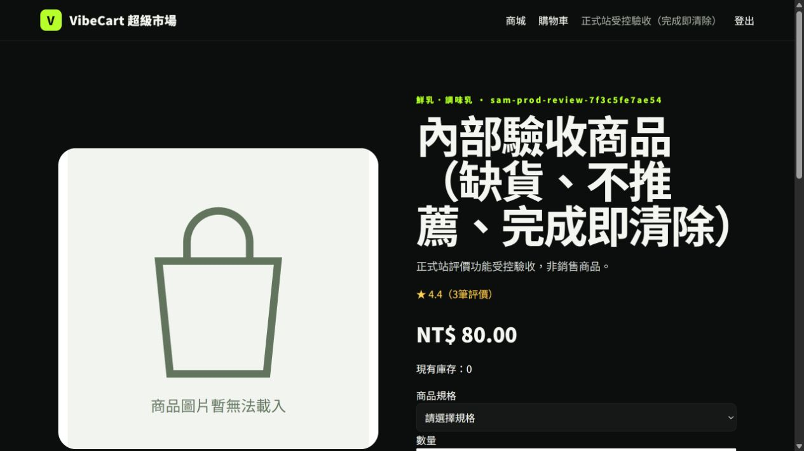
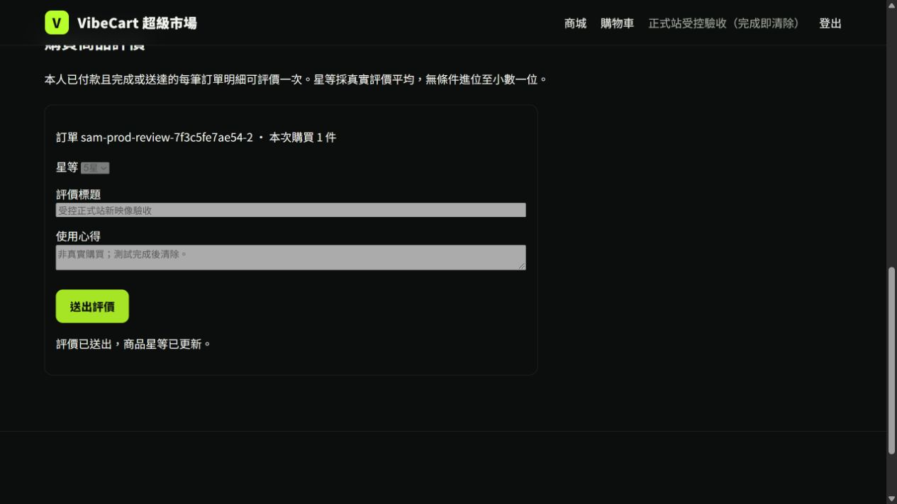

# 商品評價／猜你喜歡6＋4：現行正式版補驗

日期：2026/10/20 00:04–00:06（Asia/Taipei）。本次補上[原正式部署報告](SAM_REVIEWS_6PLUS4_PRODUCTION_2026-10-19.md)於08:58明列的缺口：當時現行N06映像已有同digest私有遠端評價及6＋4驗收，但尚無該映像的正式Firebase網頁送評畫面。主責SAM。本輪是現有發布版驗收，沒有修改程式、重建映像或重新發布Firebase Hosting。

**後續版本邊界**：以下第一輪是00:04–00:06時點的N06證據。正式站之後由另一輪發布切到`vibecart-web-ai-294c-1020`；本頁下方另記新digest的正式瀏覽器及同映像隔離排序補驗，不能把第一輪直接當作新映像證據。

## 版本與操作

正式Firebase網址為 <https://vibecart-llmai.web.app/>；驗收前控制平面讀回 `vibecart-web-n06-294c-1019` 承接100%正式流量，映像為 `sha256:796a42b6d5fd80099900abc381d4c954d21ed1bea162ad0a9a49a89355deb40a`，沿用Firebase Hosting release `sites/vibecart-llmai/releases/1792363722745000`。同digest私有服務與[四組遠端探針](inventory/reviews_n06_remote_20261019.json)此前已通過，包含6項個人＋4項高星跨類、去重及缺貨／預設星數排除。

本輪於正式Atlas只建立一組有明顯標記、缺貨且不可推薦的臨時商品／SKU、一名臨時會員，以及三筆**模擬**已付款、完成、送達的訂單明細；未發生真實付款或出貨。前兩筆以API各評4星，第三筆使用內建瀏覽器在正式Firebase商品頁送5星。送出前顯示4.0星／2筆；送出後**同一網址、未重新載入頁面**顯示4.4星／3筆，原評價表單仍在但已停用，並顯示「評價已送出，商品星等已更新。」。重新GET會移除已評價表單，因此原表單保留且停用是原頁AJAX更新的可觀察證據。

Atlas直接讀回 `rating_sum=13`、`rating_count=3`、原始平均`4.333333333333333`、顯示`4.4`，分布為4星兩筆、5星一筆。顯示值符合文件要求的**無條件進位至小數一位**；前台「4.4」不是把先前顯示4.0與新5星做二次平均。

## 推薦與清理邊界

正式首頁以這名測試會員當時讀到個人推薦6項、破圈區因符合條件商品不足顯示空位。規範為「**最多**6＋4」，不得以預設星等或測試評價補足破圈；此次測試商品缺貨且不可推薦，也未入正式推薦池。高星5、4.9、4.8、4.7的4項排序與10件去重仍以**同digest私有隔離資料**驗證，不把私有候選寫成正式真實商品。責任分工沿用原報告：REN會員／訂單／事件與登入契約；JEFF推薦候選、排序及關聯統計；SAM資料庫、前台、整合、部署與證據。

送評並讀回後，只清除這次登記ID所屬的評價、訂單明細、訂單、行為事件、登入session、會員、SKU及商品；八個集合各自的測試範圍剩餘均為0。測試登入檔已移除，既有業務資料的前後快照一致。去敏[機器摘要](inventory/reviews_n06_formal_ui_20261020.json)與上圖存放於GitHub；帳密、URI、cookie及token未納入版本庫。

本對話要求的商品評價、即時星等、6＋4高星破圈規則、正式發布及同版技術驗收至此完成。這不代替V5其他關卡、真人具名簽收、真實付款物流或長期排程的驗收；那些工作仍按各自專案清單處理。

## 正式映像變更後的接續驗收

第一輪完成後控制平面讀回正式流量已切至`vibecart-web-ai-294c-1020`／100%，映像為`sha256:03d01cb52065e21fc96db6fb34b4de0527f2eb3966abbf0fe8719cb99bcc98f2`。來源標籤仍是`294c1fac26d6785054063b8be6eb7d9e61075be4`；固定VPC／ALL_TRAFFIC保留，`AI_RECOMMENDATIONS_ENABLED=false`、`AI_SUMMARY_ENABLED=true`。Firebase Hosting release沿用前述版本。本對話沒有執行這次AI發布，也沒有回切正式流量。

00:12–00:13重新建立另一組同樣不可販售、不可推薦的受控資料，在公開Firebase網址以瀏覽器送第三筆5星。新映像原頁同樣由4.0／2筆變成4.4／3筆，表單停用且成功訊息出現。正式Atlas讀回13／3／4.4；00:13:55只清除本輪八集合登記範圍，各自剩餘0、既有業務快照不變，測試登入檔移除。

為避免沿用舊digest的排序結論，另以新digest建立私有`vibecart-acceptance-pr21-reviews-ai-1020`／0%候選，保留原私有N06修訂版100%及既有IAM。`AI_RECOMMENDATIONS_ENABLED=false`，本輪驗證規則6＋4；隔離驗收不測AI摘要。遠端評價／推薦探針通過：6項個人＋4項跨類、10件去重，跨類依5、4.9、4.8、4.7排序；小類上限3／2、缺貨與預設星數排除、1001筆synthetic隔離、錯誤評價拒絕及交易失敗回滾皆通過，該探針fixture清理verified。完整執行及資源清理結果見[新映像去敏摘要](inventory/reviews_ai_formal_ui_20261020.json)。

00:41最終讀回：四組探針（雙角色、評價／推薦、會員、交易）全數passed，各組清理verified、暫時索引還原；Job刪除讀回404。測試tag已移除，候選仍0%；刪除候選revision回HTTP400，因此保留為無tag的0%歷史修訂版，不宣稱已刪除。正式AI修訂版100%、原私有N06修訂版100%及Firebase release均符合預期。原本的N06頁面缺口與新正式digest接續驗收已完成；GitHub合併／CI以PR #124的最終狀態為準。
