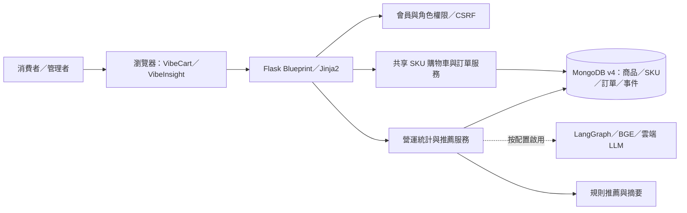
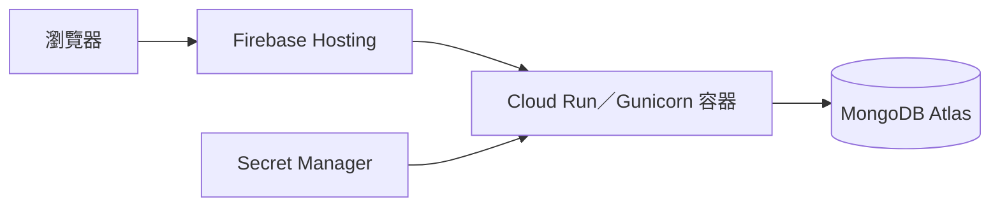

# 架構與資料流

來源：main 的網站 README、docs/FLASK_SKU_AI_INTEGRATION.md，以及整合分支 a0fcad0 的 deploy/README.md。本圖表達模組關係，功能開放與部署版本仍需最終核對。

第二張圖是 10/12 部署文件記載的雲端拓樸；本輪沒有重新查詢 revision／image digest。main 尚未包含該 deploy 目錄，不能直接從 main 推定可建置同一雲端映像。

資料流：瀏覽／搜尋→事件→推薦；購物車 SKU→示範訂單→明細→營運彙總。事件寫入、排程、synthetic 隔離及正式 D4 apply 必須另有測試證據；本次簡報整理不匯入資料。有效營收與低庫存使用不同範圍：前者受有效訂單及期間限制，後者為即時庫存。
