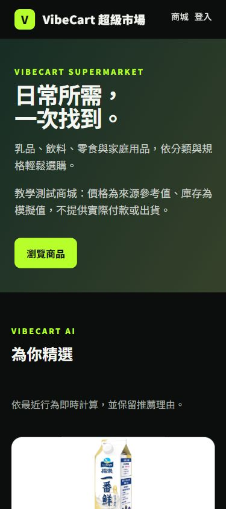
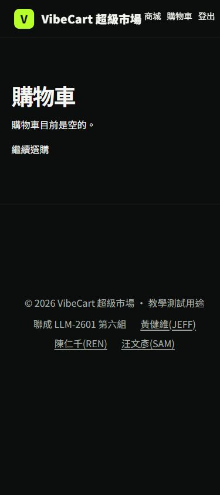
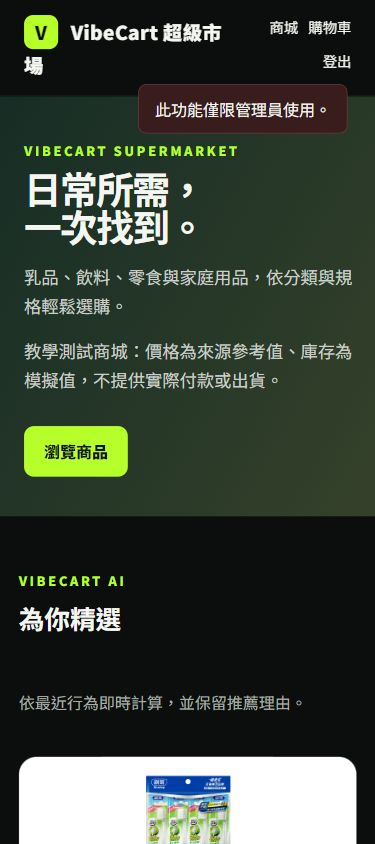
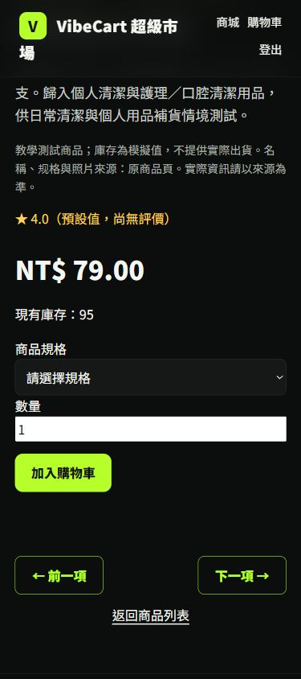
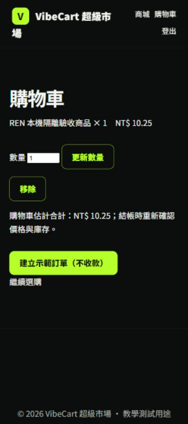
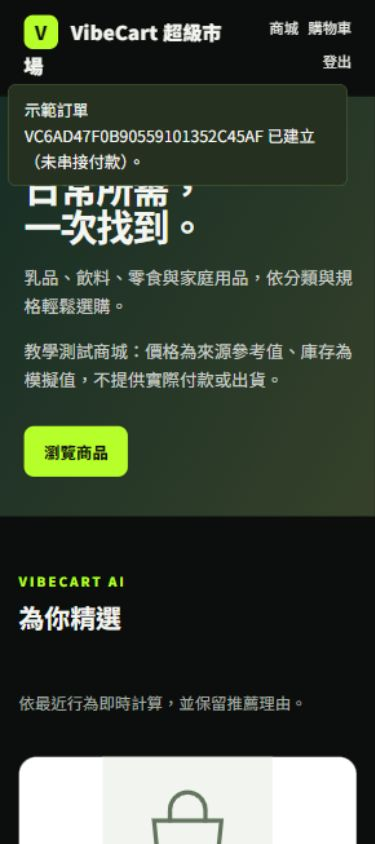
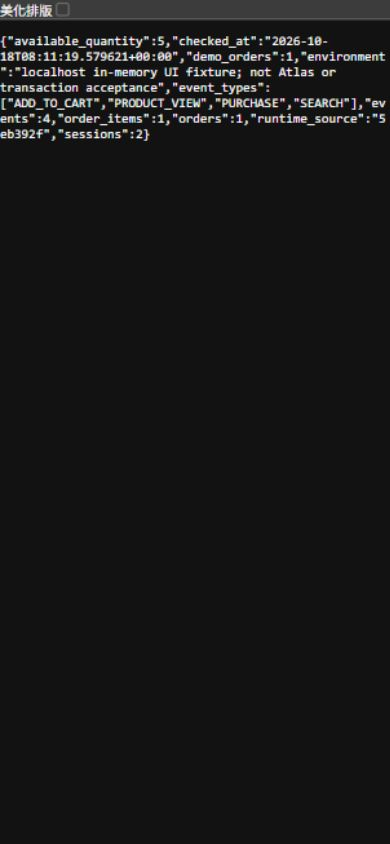
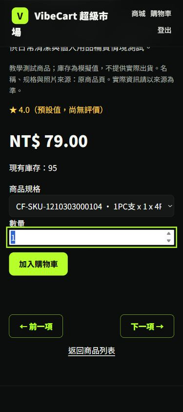
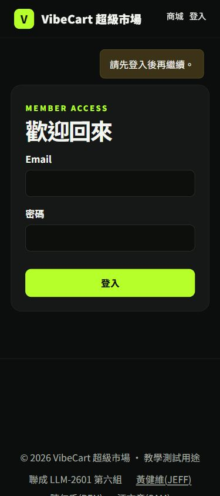

# REN H01～H09 手機尺寸截圖｜2026-10-18

預定接收人：[陳仁千（REN）](mailto:chen2000401@gmail.com)。本輪為 Codex 技術操作；本人逐項接收仍待填寫。

**390×844 尺寸模擬，Codex 內建瀏覽器；非手機實機、觸控或行動網路驗收。** 圖片為原始 JPEG；URL、時間、尺寸、環境、SHA-256 及限制見[JSON 索引](capture-records.json)與[完整報告](../../../docs/REN_MOBILE_H01_H09_2026-10-18.md)。

H01～H04、H08～H09 是正式網站前台。**H05～H07 是 localhost mongomock 記憶體 fixture**，只驗 UI；不能當 Atlas 寫入、真交易回滾、冪等、consumer 排除或真人簽認證據。Chrome 錯誤截圖已重新取證，未放入交付。

H04 價庫圖拍於選擇規格前，是商品聚合值；已選定 SKU 的證據請看 H08。兩張圖片保留各自實際操作時點。

| H01 正式首頁 | H02 正式登入回 cart | H03 正式角色拒絕 |
|---|---|---|
|  |  |  |

| H04 正式商品總價庫（未選 SKU） | H05 本機隔離 cart | H06 本機示範訂單 |
|---|---|---|
|  |  |  |

| H07 本機事件讀回 | H08 正式鍵盤焦點 | H09 正式單裝置登出後 |
|---|---|---|
|  |  |  |

補圖：[H02 登入前](H02-login.jpg)、[H04 商品全貌](H04-product-overview.jpg)、[H05 移除後](H05-removed.jpg)。[H07 原始讀回](H07-local-readback.txt)為本機資料，不是 Atlas Console。
