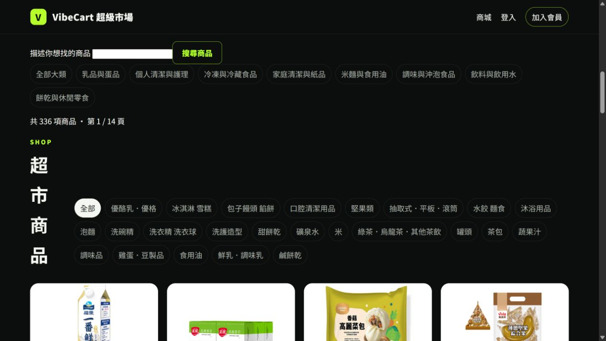
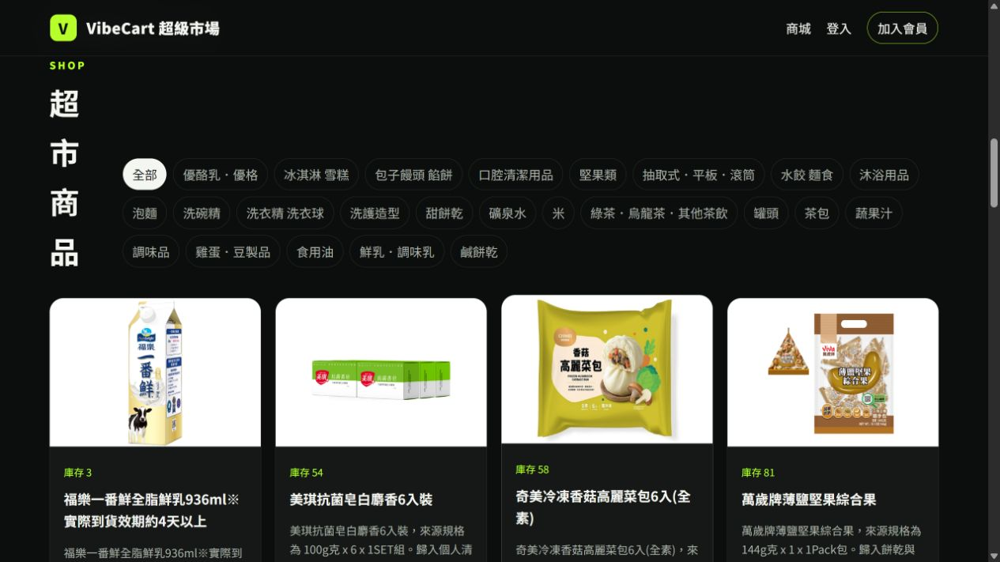
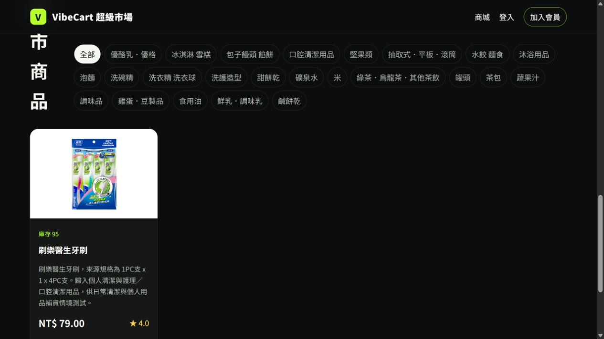
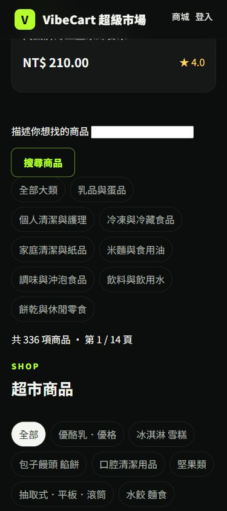
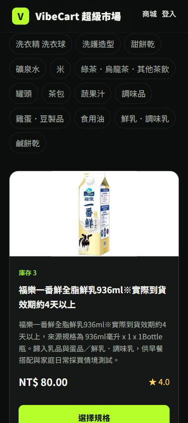

# S02 商品清單／搜尋畫面證據｜2026-10-17

執行窗口：SAM；擷取時間約 19:10～19:14（Asia/Taipei）。以匿名瀏覽器開啟正式 Firebase Hosting <https://vibecart-llmai.web.app/>，只執行公開頁面讀取與搜尋，未登入、加購或寫入資料。

| 步驟 | 畫面與操作讀回 |
|---|---|
| 首頁瀏覽商品 | 搜尋欄、八個商品大類、`共 336 項商品 · 第 1 / 14 頁`、次類別和商品卡片可見。首列包括福樂鮮乳、美琪抗菌皂、奇美高麗菜包及萬歲牌堅果；卡片有圖片與庫存。 |
| 按鈕搜尋 | 輸入「刷樂醫生牙刷」後點選「搜尋商品」，網址帶 `q`，頁面顯示 `共 1 項商品 · 第 1 / 1 頁`；唯一卡片顯示庫存 95、NT$ 79.00。 |
| 鍵盤及空結果 | 在搜尋欄輸入「不存在的測試商品XYZ」按 Enter；網址更新，頁面顯示 `共 0 項商品` 與「目前沒有符合條件的商品。」 |

三張 PNG 均為瀏覽器當時的原始 1265×711 截圖，未裁切或修飾；SHA-256 依上述順序為 `FC42ED8FD4E68B76D8CC987571068EADDF988E53B286BCCF3F122F7E0BECA5E0`、`70F032BB5C702889236230BC8D3FEB247F2D2C9A0EE4247DA713979DEA794E1F`、`EF102D508C5733CE67D517DD90073FB7FD4731B31540CC752FA9C561DC4D1998`。前一筆 [336 商品／SKU 與 Atlas 唯讀對帳](../../docs/SAM_LIVE_CATALOG_AUDIT_2026-10-17.md)提供資料值核對，S03 的[單品畫面](S03-product-evidence.md)另留證。

## 手機寬度補驗｜19:18～19:20

同一匿名公開頁面以瀏覽器 viewport override 設為 **390×844**；實際輸出 PNG 為 **375×844**。檢視首頁、搜尋與大類別、336 件／14 頁、單欄商品卡片：文字及圖片未見水平截斷，首件商品顯示庫存 3、NT$ 80.00 與「選擇規格」入口。完成後已重設 viewport。此為桌面瀏覽器的窄視窗檢查，**不是手機實機測試**。

兩張均為原始未修飾 PNG；SHA-256 依序為 `62FB422F22254B1271372F5571B13E74FBC24F85BD40E55F53C3DAC4E2E8071A`、`39CA1004151DC2F70357CB97B127009C0899E85D695E44EDEF3C2D93DA0ABCF3`。

**驗收界線：**截圖只證明擷取當時的匿名公開畫面和上述操作。Cloud Run 流量 revision／映像 digest 這次未即時讀回，不能把截圖稱作已驗明部署 SHA；手機實機、更多 RWD 斷點、整站鍵盤巡檢及具名最終簽收仍待做。本證據不涵蓋登入、結帳、真付款或 D4 consumer 隔離。
