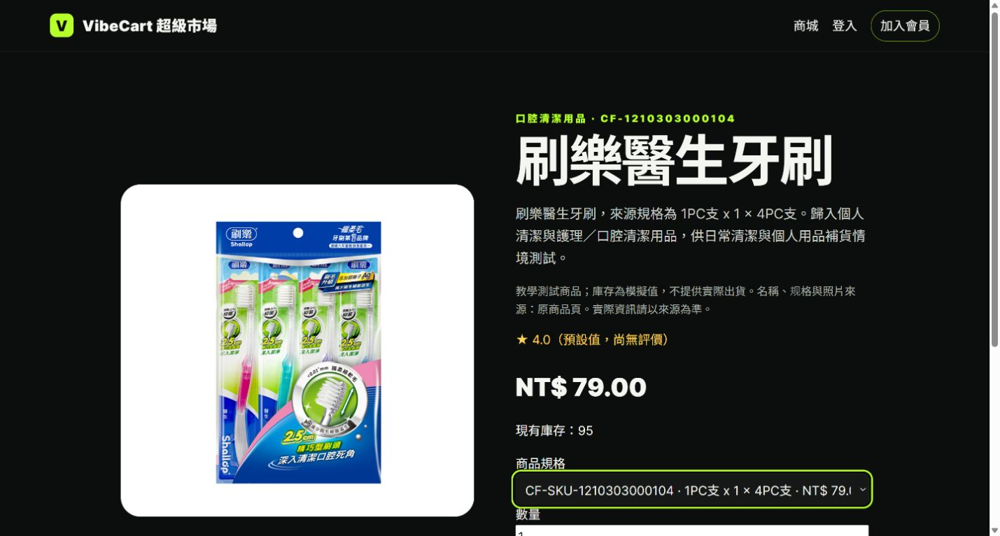

> 歷史證據：此頁10/17 PNG已移至history-20261017；同名主圖現為10/18版，請以[S01～S12最新索引](S01-S12_同版取證_2026-10-18.md)為準。

# S03 商品／SKU 畫面證據｜2026-10-17

執行窗口：SAM 暫代 REN；擷取時間約 18:55（Asia/Taipei）。本頁是 S03 的商品畫面與單一 SKU 對帳，不代表 S04 登入、S05 結帳或整站簽收。

| 項目 | 實際讀回 |
|---|---|
| 環境與網址 | 正式 Firebase Hosting：<https://vibecart-llmai.web.app/product/02f9efd17210150f2eea7274>；匿名瀏覽器 |
| Git／部署版本 | 取證時 `origin/main=af8388b370265a757b39e5815c4dabe0d3495309`；[16:06 部署紀錄](../../docs/SAM_PR21_LIVE_ACCEPTANCE_2026-10-17.md)為 `vibecart-web-00012-85f`、來源 `2fd43557bac0148e02fa427163a9657a13c7ae23`、100% 流量。本次未在截圖當刻重新讀回 Cloud Run 流量，故不能單憑圖片證明 revision 未變。 |
| 操作 | 首頁開啟「刷樂醫生牙刷」商品頁，選取唯一可用 SKU `CF-SKU-1210303000104`；截圖未按「加入購物車」。 |
| 畫面讀回 | 商品 `CF-1210303000104`、SKU 規格 `1PC支 x 1 x 4PC支`、價格 NT$79.00、現有庫存 95。 |
| Atlas 唯讀對帳 | 正式 `vibecart_ai.products` 的商品 ID `02f9efd17210150f2eea7274`、`schema_version=4`、`status=active`；`product_skus` 的該 SKU 指向同一商品，`status=active`、`price=79.00`、`available_quantity=95`。查詢限單一商品／SKU，沒有資料庫寫入。 |
| 結果 | 本次畫面價格與庫存和 Atlas SKU 讀回一致；只驗這件商品在取證當時的呈現。 |

`S03-product-source.jpg` 是瀏覽器擷取的原始 JPEG，`S03-product.png` 是以像素不裁切轉存的簡報格式，尺寸均為 1429×766。SHA-256：原始 `5BFB9222C00E7267B953BD33926B5B32FA2CD0AEAE257CEE8B8C47B3EE2D29BA`；PNG `EB894676383DB01208DBABC6202E102FA3B79BA4DDB82480B4D65ABC9CB6658C`。畫面沒有帳密或個資。依簡報清單，S03 的最終簽收仍須在交付版重新確認 revision、必要的手機畫面與核對人簽認；S04／S05 另行驗收。
