# 逐頁內容與講稿

共 13 頁，約 11～13 分鐘。以專題情境、系統架構、功能流程與驗證成果為主線。

## 01 VibeCart AI 智慧購物與營運分析

超市網購 × AI 推薦 × 資料驗證

講稿：以日常採買帶入專題。封面為 AI 概念插畫；操作畫面依 S01～S12 素材規範。

截圖對應：S01 首頁另待最終版畫面

來源：

- [來源 1](https://github.com/SamWang61/LLM_PJ/blob/7affe59b23582940a2b83085c023c4b3b8b7d1e9/README.md)

## 02 超市網購的使用情境

同一份商品與訂單資料，服務消費者與營運人員

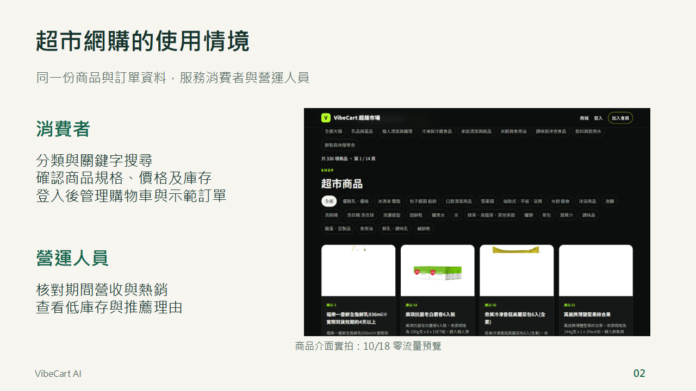

講稿：約 45 秒。消費者需要以分類和關鍵字找到商品並確認規格與價格。管理者需要核對期間營收、熱銷與即時庫存。右圖是有來源紀錄的零流量雲端預覽，屬於商品介面展示，不等於正式版已切換。

截圖對應：S01／S02；圖為 10/18 零流量雲端預覽

來源：

- [來源 1](https://github.com/SamWang61/LLM_PJ/blob/7affe59b23582940a2b83085c023c4b3b8b7d1e9/README.md)
- [來源 2](https://github.com/SamWang61/LLM_PJ/blob/7affe59b23582940a2b83085c023c4b3b8b7d1e9/%E7%B0%A1%E5%A0%B1%E6%96%87%E4%BB%B6/screenshots/S02-tablet-layout-20261018.md)

## 03 系統架構與資料流

前後台共用 SKU 與資料服務，AI 依配置執行

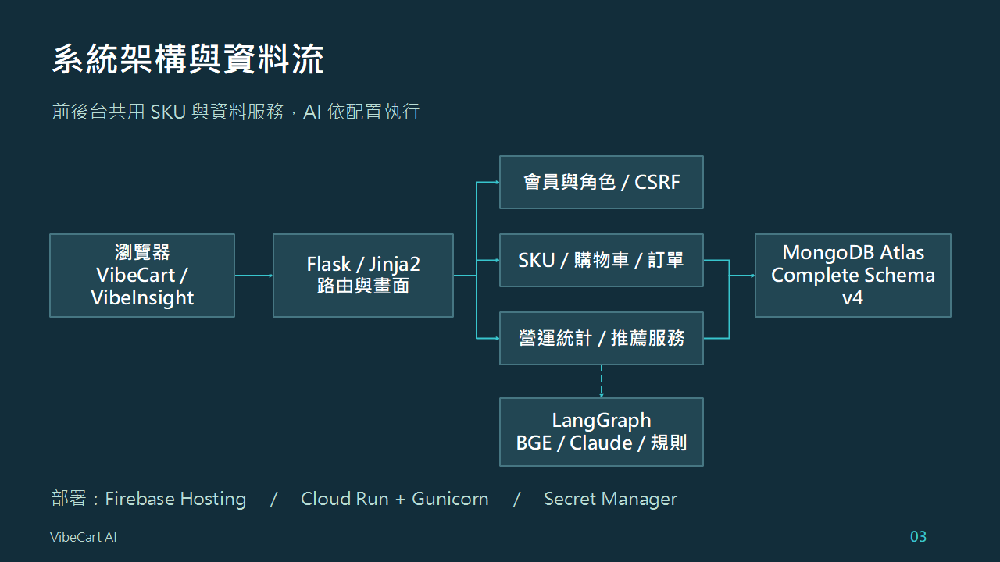

講稿：約 70 秒。Flask 和 Jinja2 組成前後台，會員服務檢查角色與 CSRF，SKU 服務處理購物車及訂單，統計與 AI 讀取有界線的資料。AI 不直接持有任意資料庫執行權限。LangGraph 編排 BGE 與 Claude，正式模型旗標仍需以同版遠端驗收確認。圖中模組與連線可在 PowerPoint 編輯。

來源：

- [來源 1](https://github.com/SamWang61/LLM_PJ/blob/7affe59b23582940a2b83085c023c4b3b8b7d1e9/docs/FLASK_SKU_AI_INTEGRATION.md)
- [來源 2](https://github.com/SamWang61/LLM_PJ/blob/7affe59b23582940a2b83085c023c4b3b8b7d1e9/deploy/README.md)
- [來源 3](https://github.com/SamWang61/LLM_PJ/blob/7affe59b23582940a2b83085c023c4b3b8b7d1e9/docs/SAM_PROGRESS_CHECKPOINT_2026-10-18.md)

## 04 資料模型與測試資料

商品與 SKU 分離，訂單保留明細與示範標記

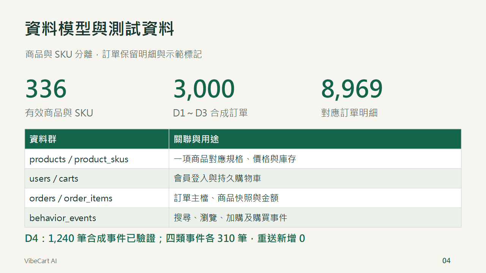

講稿：約 55 秒。336 商品和 SKU 是資料核對快照。3,000 訂單與 8,969 明細來自 D1～D3 合成批次，另有兩筆 demo，不把測試數字說成實際營業績效。D4 1,240 事件包含四事件各 310，全部有 synthetic 與 exclude_from_attribution 標記。

截圖對應：S10 schema／關聯／示範標記

來源：

- [來源 1](https://github.com/SamWang61/LLM_PJ/blob/7affe59b23582940a2b83085c023c4b3b8b7d1e9/docs/SAM_SCHEMA_AUDIT_2026-10-17.md)
- [來源 2](https://github.com/SamWang61/LLM_PJ/blob/7affe59b23582940a2b83085c023c4b3b8b7d1e9/docs/D4_IMPORT_ACCEPTANCE_2026-10-18.md)
- [來源 3](https://github.com/SamWang61/LLM_PJ/blob/7affe59b23582940a2b83085c023c4b3b8b7d1e9/docs/SAM_PROGRESS_CHECKPOINT_2026-10-18.md)

## 05 商品搜尋與 SKU 一致性

商品畫面、價格與可購庫存使用同一份 SKU 資料

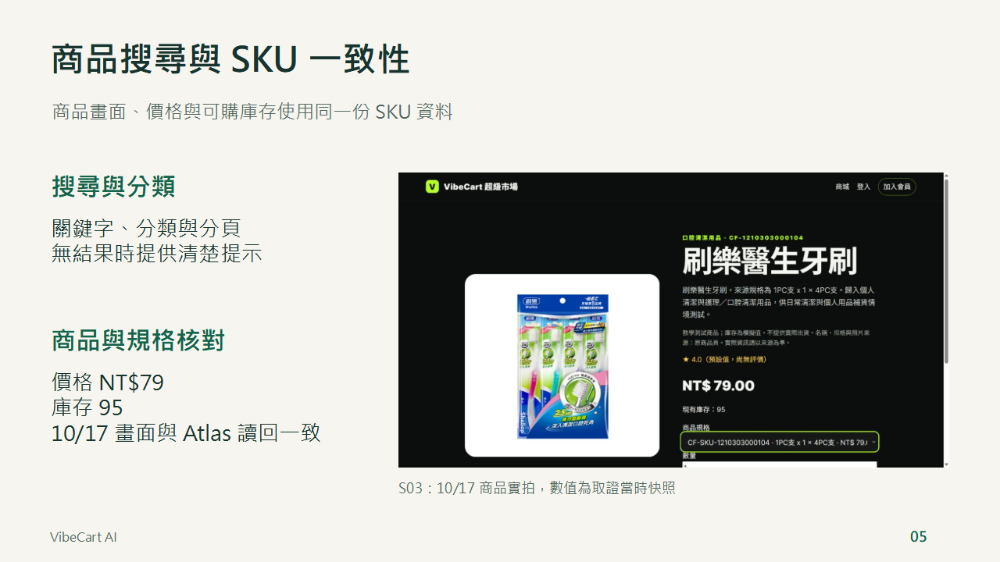

講稿：約 55 秒。以刷樂醫生牙刷為例，10/17 截圖中的價格 NT$79、庫存 95 與當時 Atlas 唯讀讀回一致。庫存是當時快照，並非本次重新即時查詢。搜尋同時要檢查有結果與無結果，分類與分頁則保持查詢條件。

截圖對應：S02 搜尋與空結果；S03 商品／SKU

來源：

- [來源 1](https://github.com/SamWang61/LLM_PJ/blob/7affe59b23582940a2b83085c023c4b3b8b7d1e9/docs/SAM_LIVE_CATALOG_AUDIT_2026-10-17.md)
- [來源 2](https://github.com/SamWang61/LLM_PJ/blob/7affe59b23582940a2b83085c023c4b3b8b7d1e9/%E7%B0%A1%E5%A0%B1%E6%96%87%E4%BB%B6/screenshots/S03-product-evidence.md)

## 06 會員登入與權限管理

每次請求檢查有效會員與管理員角色

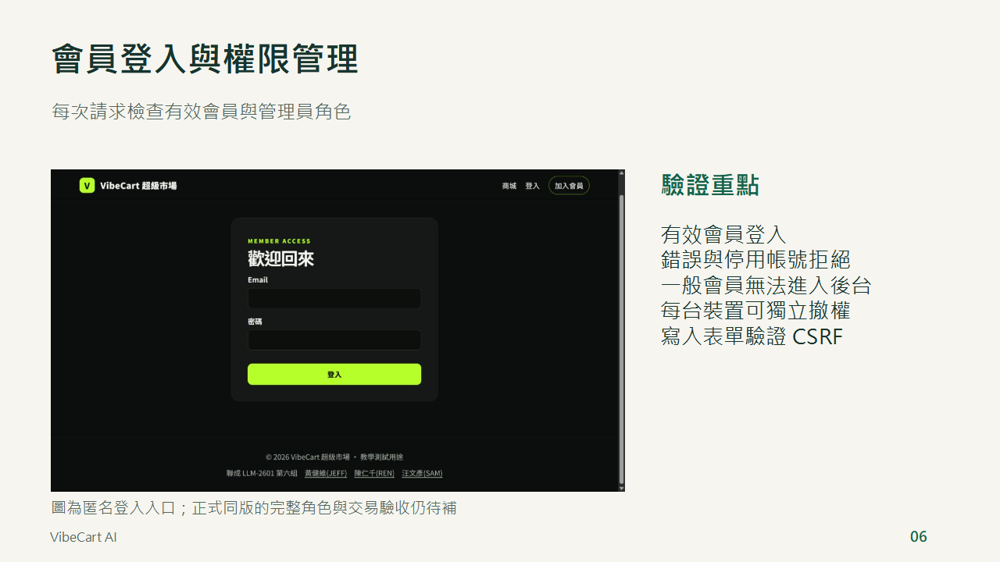

講稿：約 55 秒。左圖為正式網站匿名登入頁，沒有輸入帳密。此圖只呈現入口，登入成功、錯誤帳號、停用、跨裝置與撤權需要各自的 S04 證據。多裝置登入採可獨立撤銷的 session，不以互相踢出代表完成。

截圖對應：S04 驗證待補；此圖來源為 S11 匿名登入

來源：

- [來源 1](https://github.com/SamWang61/LLM_PJ/blob/7affe59b23582940a2b83085c023c4b3b8b7d1e9/docs/REN_AUTH_ORDER.md)
- [來源 2](https://github.com/SamWang61/LLM_PJ/blob/7affe59b23582940a2b83085c023c4b3b8b7d1e9/docs/SAM_RELEASE_2026-10-18.md)
- [來源 3](https://github.com/SamWang61/LLM_PJ/blob/7affe59b23582940a2b83085c023c4b3b8b7d1e9/docs/SAM_PROGRESS_CHECKPOINT_2026-10-18.md)

## 07 購物車與示範結帳

服務以交易、版本檢查與操作識別碼維持資料一致

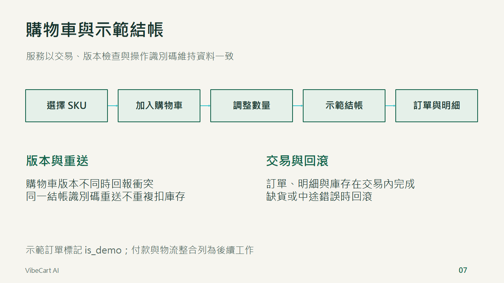

講稿：約 60 秒。選 SKU 後加購，調整數量再示範結帳，交易內建立訂單和明細並扣庫存。expected_revision 防止舊購物車覆寫，checkout_id 與 operation_id 處理相同請求重送。186 項同版本機測試涵蓋 rollback、最後庫存併發與撤權 rollback。正式修訂的完整遠端會員交易仍需補同版證據。沒有金流或物流串接。

截圖對應：S05 加購／改量／結帳／訂單與失敗情境，待補

來源：

- [來源 1](https://github.com/SamWang61/LLM_PJ/blob/7affe59b23582940a2b83085c023c4b3b8b7d1e9/docs/FLASK_SKU_AI_INTEGRATION.md)
- [來源 2](https://github.com/SamWang61/LLM_PJ/blob/7affe59b23582940a2b83085c023c4b3b8b7d1e9/docs/SAM_RELEASE_2026-10-18.md)

## 08 可解釋推薦與退回流程

先確認商品可售，再依查詢與行為資料產生推薦

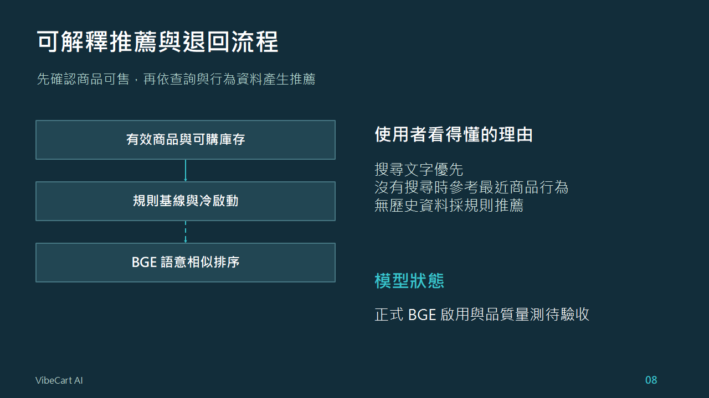

講稿：約 60 秒。候選先檢查 active、可推薦與庫存，規則基線提供冷啟動。搜尋文字或最近商品行為形成查詢，配置完成後由 BGE 做 cosine 相似度排序。模型未備妥時保留規則結果。正式 runtime 的 AI 旗標目前關閉，因此此頁講設計與程式流程，不宣稱正式模型已在線上運作。

截圖對應：S07 推薦理由／冷啟動情境待補

來源：

- [來源 1](https://github.com/SamWang61/LLM_PJ/blob/7affe59b23582940a2b83085c023c4b3b8b7d1e9/docs/FLASK_SKU_AI_INTEGRATION.md)
- [來源 2](https://github.com/SamWang61/LLM_PJ/blob/7affe59b23582940a2b83085c023c4b3b8b7d1e9/docs/SAM_PROGRESS_CHECKPOINT_2026-10-18.md)

## 09 營運總覽與資料口徑

管理者使用同一期間、同一示範範圍核對數字

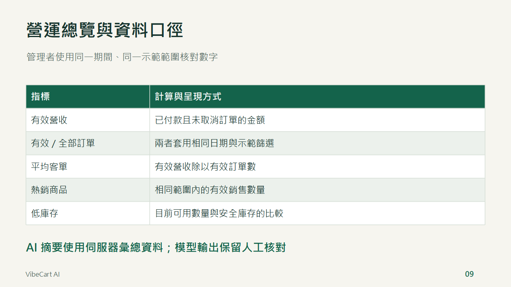

講稿：約 60 秒。有效營收採已付款且未取消的訂單，平均客單以有效訂單計算，沒有有效訂單時顯示空值。低庫存反映當前可用數量，不能當歷史庫存。S06 同版管理員畫面與資料對帳未齊，這一頁使用可編輯的定義表呈現已實作口徑，沒有填入虛構營收或 KPI。

截圖對應：S06 期間篩選／KPI／熱銷，同版操作圖待補

來源：

- [來源 1](https://github.com/SamWang61/LLM_PJ/blob/7affe59b23582940a2b83085c023c4b3b8b7d1e9/docs/AI_DASHBOARD.md)

## 10 規則、BGE 與 Claude 的分工

比較用途、資料範圍與可量測結果

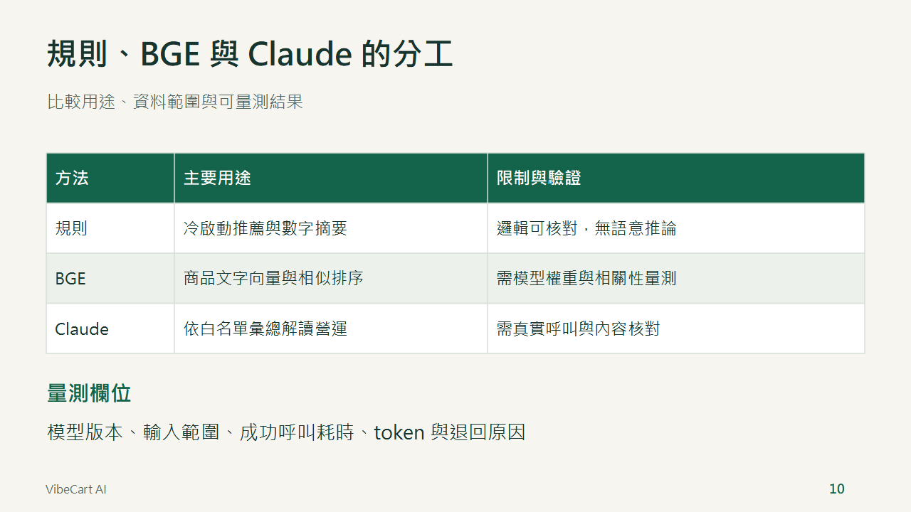

講稿：約 65 秒。規則提供可核對的基線，BGE 處理商品語意相似，Claude 依白名單彙總產生營運說明。三者任務不同，不把相似度與文字摘要當成同一準確率。正式模型和自由提問仍待遠端驗收，不填造耗時、token 或成本。真模型實測需註明配置、輸入、樣本和執行環境。

截圖對應：S08 同輸入／實際狀態／耗時／失敗退回，待補

來源：

- [來源 1](https://github.com/SamWang61/LLM_PJ/blob/7affe59b23582940a2b83085c023c4b3b8b7d1e9/docs/AI_DASHBOARD.md)
- [來源 2](https://github.com/SamWang61/LLM_PJ/blob/7affe59b23582940a2b83085c023c4b3b8b7d1e9/docs/SAM_PROGRESS_CHECKPOINT_2026-10-18.md)

## 11 部署與測試證據

公開路由、本機交易測試與手機驗收各自留證

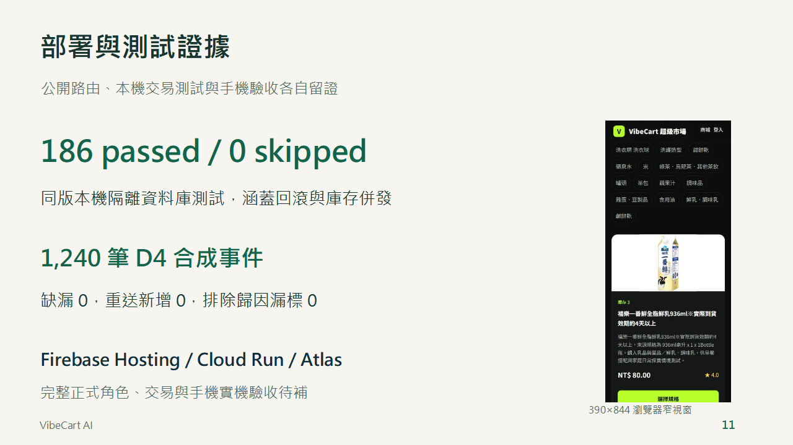

講稿：約 70 秒。186 passed／0 skipped 為 80513a9 同版本機隔離 MongoDB 測試。D4 1,240 筆 apply、verify 和重送完成，並有 synthetic 排除歸因標記。正式發布紀錄 00013-ds5 在 00:12 為 100% 流量，此次簡報編輯沒有重新讀管理端。右圖為 390×844 瀏覽器窄視窗，不當作手機實機驗收。S09 Actions、S11 管理端與 S12 完整裝置畫面仍需補最終版本。

截圖對應：S09 CI、S11 deployment、S12 mobile；右圖僅瀏覽器窄視窗

來源：

- [來源 1](https://github.com/SamWang61/LLM_PJ/blob/7affe59b23582940a2b83085c023c4b3b8b7d1e9/docs/SAM_RELEASE_2026-10-18.md)
- [來源 2](https://github.com/SamWang61/LLM_PJ/blob/7affe59b23582940a2b83085c023c4b3b8b7d1e9/docs/D4_IMPORT_ACCEPTANCE_2026-10-18.md)
- [來源 3](https://github.com/SamWang61/LLM_PJ/blob/7affe59b23582940a2b83085c023c4b3b8b7d1e9/%E7%B0%A1%E5%A0%B1%E6%96%87%E4%BB%B6/screenshots/S02-catalog-evidence.md)

## 12 下一階段工作項目

功能擴充與交付前驗收分開呈現

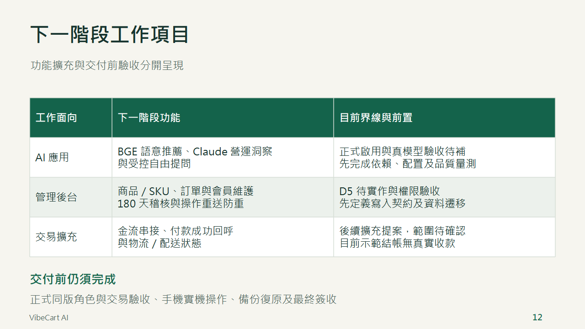

講稿：約 60～75 秒。本頁區分三種工作。AI 既有模組需完成正式配置、真模型品質與自由提問驗收；D5 的商品、SKU、訂單與會員維護及 180 天稽核、冪等收據仍需實作。金流與物流屬後續擴充提案，尚未確認排程，也沒有實際收款。現有網站功能的正式同版驗收、手機實機及備份復原屬交付前工作，不因列入本頁而延後或視為完成。最新紀錄已有同映像私有環境會員及交易驗收，但不等於正式業務庫與全站最終簽收。

來源：

- [來源 1](https://github.com/SamWang61/LLM_PJ/blob/b209c58ada7aaaffc78446b6124206c2392d06e7/docs/SAM_PROGRESS_CHECKPOINT_2026-10-18.md)
- [來源 2](https://github.com/SamWang61/LLM_PJ/blob/b209c58ada7aaaffc78446b6124206c2392d06e7/docs/JEFF_ADMIN_UI_DESIGN.md)
- [來源 3](https://github.com/SamWang61/LLM_PJ/blob/b209c58ada7aaaffc78446b6124206c2392d06e7/docs/FLASK_SKU_AI_INTEGRATION.md)

## 13 成果、團隊與後續工作

已交付的資料、流程與證據，持續補足正式驗收

講稿：介紹成果、後續工作與團隊，封底使用使用者提供合照的整版浮水印。

來源：

- [來源 1](https://github.com/SamWang61/LLM_PJ/blob/7affe59b23582940a2b83085c023c4b3b8b7d1e9/README.md)
- [來源 2](https://github.com/SamWang61/LLM_PJ/blob/7affe59b23582940a2b83085c023c4b3b8b7d1e9/docs/SAM_PROGRESS_CHECKPOINT_2026-10-18.md)

## 完整聯絡資料

| 身分 | 學號 | 中文姓名／英文名 | Email |
|---|---|---|---|
| 組員 | 106104063 | [黃健維 JEFF](mailto:jeff841117@gmail.com) | [jeff841117@gmail.com](mailto:jeff841117@gmail.com) |
| 組員 | 105910496 | [陳仁千 REN](mailto:chen2000401@gmail.com) | [chen2000401@gmail.com](mailto:chen2000401@gmail.com) |
| 組員 | 106084164 | [汪文彥 SAM](mailto:cashsam@gmail.com) | [cashsam@gmail.com](mailto:cashsam@gmail.com) |
| 指導講師 | — | [簡志璁 Alvin](mailto:fcaibialvin@gmail.com) | [fcaibialvin@gmail.com](mailto:fcaibialvin@gmail.com) |
